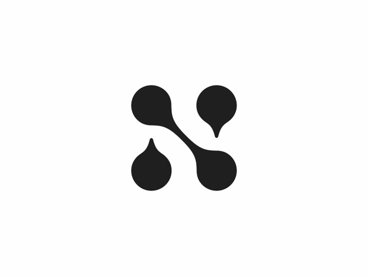

# 🧠 Neura — Machine Learning Chat Assistant

Neura adalah platform asisten Machine Learning interaktif berbasis **TensorFlow** dan arsitektur **MVC (Model-View-Controller)** yang modular, dilengkapi dengan antarmuka web modern bergaya **Claude AI** (Anthropic) dengan akurasi visual tinggi.



---

## ✨ Fitur Utama

- **🎨 Claude AI Interface (~95% Visual Fidelity):**
  - Palet warna hangat *Warm Linen* (`#FAF9F5`) dan *Oat Sidebar* (`#F0EEE6`).
  - Aksen warna *Terracotta / Burnt Orange* (`#D97757`) khas Anthropic Claude.
  - Tipografi elegan kombinasi *Newsreader* (serif) & *Inter* (sans-serif).
  - Dynamic Island notch di bagian atas dengan status model dan animasi transisi halus.
  - Hero action cards untuk training, prediksi, evaluasi, dan inspeksi arsitektur.
  - Floating bottom input card dengan auto-grow textarea dan quick-command pills.
  - Mode ganda: **Warm Linen (Light)** dan **Obsidian (Dark)**.
  - Model architecture modal / popover.

- **🤖 TensorFlow Machine Learning Backend:**
  - Multi-Layer Perceptron (MLP) dengan Keras 3 / TensorFlow.
  - 128 input features $\rightarrow$ Dense(64, ReLU) $\rightarrow$ Dense(32, ReLU) $\rightarrow$ 10 output classes (Softmax).
  - Training asynchronous (thread-safe) dengan progress tracking real-time.
  - Evaluasi metrik (loss, accuracy) tersimpan otomatis ke `public/reports/`.
  - Inferensi sample dengan visualisasi probabilitas top 5 kelas.

- **🏛️ Arsitektur MVC Modular:**
  - Pemisahan ketat antara `public/` (asset produksi, checkpoint, reports, frontend) dan `src/dev/` (kode sumber, model, controller, data pipeline).

---

## 📁 Struktur Direktori

```
Neura/
├── public/                       # Aset publik & frontend produksi
│   ├── index.html                # Claude AI Chat Interface
│   ├── css/                      # Stylesheet eksternal (style.css)
│   ├── js/                       # Client-side scripts (app.js)
│   ├── assets/                   # Logo & favicon aset
│   ├── checkpoints/              # Checkpoint model terlatih (.keras)
│   └── reports/                  # Log & laporan evaluasi (.json)
├── features/                     # Modul fitur & dataset percakapan
│   ├── __init__.py               # Package export
│   ├── chat_dataset.py           # Kumpulan array percakapan terklasifikasi
│   ├── chat_dataset.json         # Export JSON dataset percakapan
│   └── chat_manager.py           # Manager pencarian, filter, & intent matcher
├── src/
│   ├── dev/                      # Core backend & modul machine learning
│   │   ├── controllers/          # Business logic & command handler
│   │   ├── models/               # Model neural network & abstract base
│   │   ├── views/                # CLI view & formatter
│   │   ├── data/                 # Dataset loader & synthetic generator
│   │   └── utils/                # Config loader & logging
│   ├── data/                     # Raw & processed data
│   └── public/                   # Shared public library
├── server.py                     # Flask web server & REST API
├── main.py                       # CLI entry point
├── requirements.txt              # Dependencies produksi
├── requirements-dev.txt          # Dependencies development & testing
└── README.md                     # Dokumentasi project & tutorial
```

---

## 🚀 Panduan Setup & Menjalankan Project (Tutorial dari Awal)

Ikuti langkah-langkah di bawah ini untuk menginstal pustaka dan menjalankan Neura dari nol di komputer Anda:

### 1. Prasyarat Sistem
- **Python 3.10 - 3.12** terinstal pada sistem (pastikan centang *"Add python.exe to PATH"* saat instalasi).
- **Git** terinstal pada sistem.

---

### 2. Langkah-langkah Instalasi

#### Langkah 1: Clone Repository & Buka Folder Project
Buka terminal (PowerShell, Command Prompt, atau Terminal di VS Code / editor Anda), lalu jalankan:
```bash
git clone https://github.com/HanzzSama/Neura.git
cd Neura
```

#### Langkah 2: Buat Virtual Environment (`venv`)
Membuat virtual environment bertujuan mengisolasi pustaka (*packages*) agar tidak bentrok dengan instalasi Python sistem:
```bash
python -m venv venv
```

#### Langkah 3: Aktifkan Virtual Environment
Pilih perintah yang sesuai dengan terminal / sistem operasi yang Anda gunakan:

- **Windows (PowerShell):**
  ```powershell
  .\venv\Scripts\Activate.ps1
  ```
  > [!TIP]
  > **Jika muncul error Execution Policy di PowerShell** (*"cannot be loaded because running scripts is disabled on this system"*), jalankan perintah berikut sekali saja untuk mengizinkan script lokal:
  > ```powershell
  > Set-ExecutionPolicy -ExecutionPolicy RemoteSigned -Scope CurrentUser
  > ```
  > Setelah itu, jalankan kembali perintah aktivasi: `.\venv\Scripts\Activate.ps1`.

- **Windows (Command Prompt / CMD):**
  ```cmd
  venv\Scripts\activate.bat
  ```

- **macOS / Linux:**
  ```bash
  source venv/bin/activate
  ```

*Tanda berhasil:* Akan muncul teks `(venv)` di sebelah kiri baris perintah terminal Anda.

#### Langkah 4: Install Seluruh Dependencies
Setelah `(venv)` aktif, perbarui `pip` dan pasang seluruh pustaka yang diperlukan (`Flask`, `TensorFlow`, `scikit-learn`, `pandas`, dll.):
```bash
python -m pip install --upgrade pip
pip install -r requirements.txt
```

---

### 3. Menjalankan Neura

#### Opsi A: Menjalankan Web UI (Rekomendasi)
Pastikan `venv` dalam keadaan aktif, lalu jalankan server:
```bash
python server.py
```

> [!NOTE]
> Jika tidak ingin mengaktifkan venv manual terlebih dahulu di Windows, Anda bisa langsung mengeksekusi interpreter Python milik venv:
> ```powershell
> .\venv\Scripts\python.exe server.py
> ```

Setelah server berjalan dengan pesan `Running on http://127.0.0.1:5000`, buka browser dan akses:
👉 **[http://localhost:5000](http://localhost:5000)**

#### Opsi B: Menjalankan via Terminal / CLI Mode
Anda juga dapat berinteraksi langsung melalui antarmuka konsol tanpa membuka browser:
```bash
python main.py
```

---

### 4. ⚠️ Solusi Masalah Umum (Troubleshooting)

| Masalah / Pesan Error | Penyebab | Solusi |
|---|---|---|
| `ModuleNotFoundError: No module named 'flask'` | Terminal menjalankan Python global sistem yang belum terpasang dependencies, bukan Python di dalam virtual environment `venv`. | 1. Aktifkan venv terlebih dahulu: `.\venv\Scripts\Activate.ps1`<br>2. Atau jalankan langsung: `.\venv\Scripts\python.exe server.py`<br>3. Pastikan sudah menjalankan `pip install -r requirements.txt`. |
| `cannot be loaded because running scripts is disabled` | Kebijakan keamanan eksekusi script di PowerShell Windows belum mengizinkan script lokal. | Jalankan perintah `Set-ExecutionPolicy -ExecutionPolicy RemoteSigned -Scope CurrentUser` di PowerShell, lalu ulangi aktivasi venv. |
| `Address already in use` / Port 5000 bentrok | Ada instance server lama yang masih berjalan di port 5000. | Hentikan proses yang berjalan di port 5000 atau ganti port di baris akhir `server.py` (misal ke `port=5001`). |

---

## 💬 Perintah Chat Interaktif (ML Commands)

Anda dapat mengetik perintah berikut di kolom chat:

| Perintah | Deskripsi |
|---|---|
| `/status` | Cek status model, kesiapan checkpoint, dan environment |
| `/train [N]` | Melatih model selama N epoch (default: 5) |
| `/eval` | Evaluasi model pada dataset pengujian (test loss & accuracy) |
| `/predict` | Menjalankan inferensi dan menampilkan top 5 probabilitas kelas |
| `/progress` | Menampilkan progres dan log epoch pelatihan terbaru |
| `/help` | Menampilkan panduan seluruh perintah |

---

## 🔌 REST API Endpoints

| Method | Endpoint | Deskripsi |
|---|---|---|
| `GET` | `/` | Melayani web chat UI (`public/index.html`) |
| `GET` | `/api/status` | Informasi status model & server |
| `POST` | `/api/train` | Memulai training model secara async (`{"epochs": 5}`) |
| `GET` | `/api/train/progress` | Mendapatkan progres training real-time |
| `POST` | `/api/evaluate` | Menjalankan evaluasi test metrics |
| `POST` | `/api/predict` | Menjalankan inferensi pada sampel data |
| `GET` | `/api/features/categories` | Mendapatkan daftar kategori dataset & statistik |
| `GET` | `/api/features/chat-dataset` | Query dataset percakapan (filter `?category=` atau `?q=`) |
| `POST` | `/api/chat` | Memproses percakapan cerdas berbasis dataset (`{"message": "..."}`) |

---

## 🛠️ Lisensi & Kredit

- **Engine:** TensorFlow, Keras, Flask
- **UI Design:** Terinspirasi dari [Claude AI](https://claude.ai) oleh Anthropic.
