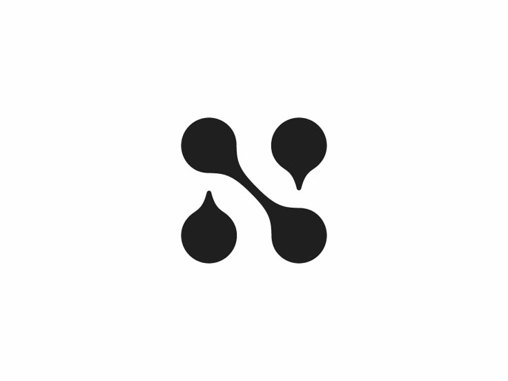

# 🧠 Neura AI — Infrastruktur Klinis Deteksi Dini Alzheimer

<div align="center">



**Platform Kecerdasan Buatan Klinis Berbasis 32 Biomarker Multimodal untuk Evaluasi Dini Risiko Penyakit Alzheimer.**

[](https://github.com/HanzzSama/Neura)
[](https://github.com/HanzzSama/Neura)
[](https://python.org)
[](https://flask.palletsprojects.com)
[-00758F?style=flat-square&logo=mysql&logoColor=white)](https://laragon.org)
[](https://xgboost.readthedocs.io)
[](nterli.py)
[](LICENSE)

</div>

---

## 📋 Daftar Isi Project

- [Tentang Platform](#-tentang-platform)
- [Fitur Utama](#-fitur-utama)
- [Arsitektur Sistem (Clean Architecture)](#-arsitektur-sistem-clean-architecture)
- [Struktur Direktori Modern](#-struktur-direktori-modern)
- [Skema Database Relasional MySQL](#-skema-database-relasional-mysql-neura_db)
- [CLI Console Management: nterli](#-cli-console-management-nterli)
- [Tutorial Instalasi & Menjalankan Project](#-tutorial-instalasi--menjalankan-project)
- [Panduan Instalasi Library Python Sesuai Kebutuhan](#-panduan-instalasi-library-python-sesuai-kebutuhan)
- [Konfigurasi Environment (.env)](#-konfigurasi-environment-env)
- [REST API Endpoints](#-rest-api-endpoints)
- [Sistem Autentikasi Admin 2FA](#-sistem-autentikasi-admin-2fa)
- [Perintah Chat Interaktif](#-perintah-chat-interaktif)
- [Dataset & Model Machine Learning](#-dataset--model-machine-learning)
- [Neura LLM — Model Generatif Lokal](#-neura-llm--model-generatif-lokal)
- [Voice AI Agent (WebRTC LiveKit)](#-voice-ai-agent-webrtc-livekit)
- [Git — Push, Pull & Kolaborasi](#-git--push-pull--kolaborasi)
- [Troubleshooting](#-troubleshooting)
- [Kontribusi & Tim Pengembang](#-kontribusi--tim-pengembang)
- [Lisensi](#-lisensi)

---

## 🎯 Tentang Platform

**Neura AI** (Codename: _Iris_, v2.0.0) adalah infrastruktur kecerdasan buatan klinis yang dirancang khusus untuk mendukung evaluasi dini risiko penyakit Alzheimer. Platform ini mengintegrasikan model *gradient boosting* XGBoost 25 trees dengan evaluasi pohon murni CPU-only (*PureTreeEvaluator*) yang terlatih pada 2.149 rekam medis dengan **32 biomarker multimodal**, mencapai akurasi prediksi **94.4%** dan ROC-AUC **0.933**.

Neura AI dirancang dengan standar **Clean Architecture Modular** yang terpisah jelas antara controller HTTP, service domain (ML, LLM, Database, Voice, Notification), model relasional data, konfigurasi terpusat, dan penyimpanan persisten:

- **Landing Page Editorial:** Desain editorial bernuansa *Warm Linen* (`#FAF9F5`) dan *Terracotta* (`#D97757`) dengan efek parallax scroll halus.
- **Workspace AI Interaktif:** Antarmuka obrolan klinis berkelas dengan panel analitik probabilitas, visualisasi biomarker, dan export dokumen resmi nakes.
- **Basis Data Relasional MySQL (Laragon):** Penyimpanan terpusat pada `neura_db` dengan integritas foreign key antara pasien, rekam medis, dokter spesialis, riwayat inferensi, dan publikasi riset.
- **Admin Database Canvas:** Visualisasi kanvas entitas relasional interaktif untuk memonitor isi tabel, skema kolom, dan rekaman data secara real-time.
- **Asisten Suara Real-time:** Voice AI Agent berbasis LiveKit WebRTC + Deepgram STT + OpenAI GPT-4o untuk konsultasi verbal interaktif.
- **CLI Console Manajemen `nterli`:** Perintah konsol terpadu untuk menjalankan server, migrasi skema database, seeding data awal, training model, pengecekan status, dan testing otomatis.

---

## ✨ Fitur Utama

### 🤖 Kecerdasan Buatan & Machine Learning
| Fitur | Spesifikasi Teknis |
| :--- | :--- |
| **Model Inti** | XGBoost Gradient Boosting (25 Decision Trees) |
| **Inference Engine** | `PureTreeEvaluator` (Evaluasi simpul pohon murni Python CPU-only tanpa dependensi C++ biner) |
| **Align Model ML** | Pemetaan logit $z = \sum_{t=1}^{25} \text{score}_t - 0.05$ dengan aktivasi sigmoid $P = \frac{1}{1 + e^{-z}}$ |
| **Input Biomarker** | 32 biomarker multimodal klinis (MMSE, ADL, memori, kardiovaskular, lab darah) |
| **Dataset Primer** | 2.149 baris rekam medis kohort Alzheimer (`database/datasets/alzheimers_disease_data.csv`) |
| **Performa Prediksi** | Akurasi: **94.4%** \| ROC-AUC: **0.933** \| Latensi inferensi: **< 50ms** |

### 🏥 Layanan Klinis & Telemedisin
- **Penerbitan Dokumen Resmi Konsultasi:** Otomatisasi generate dokumen ringkasan klinis berformat PDF / lembar cetak dengan ID rujukan nakes unik (format `NKS-YY-XXXX-ALZ`).
- **Verifikasi Rekam Medis Dokter:** Validasi 1-klik bagi dokter spesialis neurologi untuk mereview skor probabilitas risiko dan mencantumkan tanda tangan verifikasi digital.
- **Eksplorasi Kanvas Basis Data:** Inspeksi visual 9 tabel & entitas data (MySQL + Data Lake CSV) dengan drawer inspektor rekaman JSON dinamis.

---

## 🏛️ Arsitektur Sistem (Clean Architecture)

Neura AI menerapkan pola arsitektur modular berstandar tinggi:

```
+---------------------------------------------------------------------------------------+
|                                    NEURA AI ARCHITECTURE                              |
+---------------------------------------------------------------------------------------+
|  PRESENTATION LAYER (Web Clients & Browsers)                                          |
|  - welcome.html (Landing Page & Parallax Scroller)                                    |
|  - index.html   (Clinical Workspace AI & Claude-style Chat)                           |
|  - struktur.html (Admin Database & Entity Canvas Visualizer)                          |
+-------------------------------------------+-------------------------------------------+
                                            | HTTP / REST API (Port 5000)
+-------------------------------------------v-------------------------------------------+
|  ROUTING LAYER (routes/)                                                              |
|  - routes/web.py    --> Serves SPA static HTML & web assets                           |
|  - routes/api.py    --> Public API (/predict, /consultation, /chat, /livekit)         |
|  - routes/admin.py  --> Admin API (/api/admin/*, /api/database/*)                     |
+-------------------------------------------+-------------------------------------------+
                                            | Dispatch to Controllers
+-------------------------------------------v-------------------------------------------+
|  HTTP CONTROLLERS (app/Http/Controllers/)                                             |
|  - Admin/  : AdminAuthController, AdminDatabaseController, AdminResearchController   |
|  - Nakes/  : NakesAuthController, NakesConsultationController                         |
|  - User/   : UserPredictController, UserConsultationController, UserChatController    |
|  - Shared/ : StatusController, FirebaseController                                     |
+-------------------------------------------+-------------------------------------------+
                                            | Invokes Business & Domain Services
+-------------------------------------------v-------------------------------------------+
|  DOMAIN SERVICES LAYER (app/Services/)                                                |
|  - Services/ML/        : XGBoostInferenceService, XGBoostTrainerService               |
|  - Services/Database/  : DatabaseManager, ConnectionPool (MySQL neura_db)             |
|  - Services/LLM/       : LLMManagerService, GGUFBridgeService                         |
|  - Services/Voice/     : LiveKitVoiceService, AudioProcessor                          |
|  - Services/Notification/: EmailService, SMTP OTP Dispatcher                          |
+---------------------+---------------------+---------------------+---------------------+
                      |                     |                     |
+---------------------v-----+ +-------------v-------+ +-----------v---------------------+
| DATA MODELS (app/Models/) | | CONFIGS (config/)   | | PERSISTENT STORAGE (storage/)   |
| - User, UserProfile       | | - app.py            | | - checkpoints/ (xgboost.json)   |
| - Nakes, Consultation     | | - database.py       | | - framework/sessions/           |
| - PredictionRecord        | | - ml.py             | | - modelsLLM/ (GGUF Binaries)    |
| - ResearchDispatch        | | - mail.py           | | - reports/ & logs/              |
+---------------------------+ +---------------------+ +---------------------------------+
```

---

## 📁 Struktur Direktori Modern

```
Neura/
├── app/                                # CORE LOGIKA APLIKASI
│   ├── Http/
│   │   ├── Controllers/               # Controller Request-Response
│   │   │   ├── Admin/                 # AdminAuth, AdminDatabase, AdminResearch, AdminMl
│   │   │   ├── Nakes/                 # NakesAuth, NakesConsultation
│   │   │   ├── User/                  # UserPredict, UserConsultation, UserChat, UserProfile
│   │   │   └── Shared/                # StatusController, FirebaseController
│   │   └── Middleware/                # AuthGuard, SessionMiddleware, RoleMiddleware
│   ├── Models/                        # Entity Model MySQL (User, Consultation, PredictionRecord)
│   └── Services/                      # Domain Logic & Eksekusi Komputasi
│       ├── Database/                  # DatabaseManager (MySQL Connection Pool Laragon)
│       ├── LLM/                       # LLMManagerService, GGUFBridge (Llama 3.2 1B)
│       ├── Logger/                    # LoggerService (Rich Console & File Logger)
│       ├── ML/                        # XGBoostInferenceService (PureTreeEvaluator)
│       ├── Notification/              # EmailService (SMTP Gmail 2FA OTP)
│       └── Voice/                     # LiveKitVoiceService (WebRTC Audio)
│
├── bootstrap/                          # INISIALISASI & BOOTSTRAPPER APLIKASI
│   ├── app.py                         # Factory Flask App, CORS, Error Handlers, Provider Init
│   └── providers.py                   # Service Providers (MySQL Check & ML Pre-warming)
│
├── config/                             # KONFIGURASI TERPUSAT
│   ├── app.py                         # App Environment & Keys
│   ├── database.py                    # Konfigurasi Koneksi MySQL (Laragon 3306)
│   ├── mail.py                        # Konfigurasi SMTP Email
│   └── ml.py                          # Hyperparameter ML & Path Model
│
├── database/                           # BASIS DATA, MIGRASI & DATASET
│   ├── datasets/                      # alzheimers_disease_data.csv (2.149 baris)
│   ├── migrations/                    # schema.sql (Skema Tabel Relasional MySQL)
│   └── seeders/                       # DatabaseSeeder.py (Penyedia Data Awal)
│
├── public/                             # STATIC WEB ROOT
│   ├── assets/                        # Logo, gambar ilustrasi, avatar
│   ├── css/                           # style.css, welcome.css, struktur.css, auth-hero.css
│   ├── js/                            # app.js, welcome.js, struktur.js, auth-hero.js
│   ├── index.html                     # Workspace Chat & Panel Prediksi Pasien
│   ├── welcome.html                   # Landing Page Editorial
│   ├── struktur.html                  # Admin Database & Entity Canvas Visualizer
│   └── verify-email.html              # Halaman Verifikasi Email
│
├── routes/                             # DEFINISI ROUTING FLASK
│   ├── __init__.py                    # Registrasi Otomatis Seluruh Blueprint
│   ├── admin.py                       # Route /api/admin/* & /api/database/*
│   ├── api.py                         # Route /api/predict, /api/consultation, /api/chat
│   └── web.py                         # Route Halaman Web (/, /app, /welcome, /struktur)
│
├── storage/                            # DATA PERSISTEN & CHECKPOINT (Aman dari Git)
│   ├── app/                           # File penyimpanan lokal (JSON fallback & notifikasi)
│   ├── checkpoints/                   # xgboost_alzheimers.json (Checkpoint 25 Trees)
│   ├── framework/
│   │   └── sessions/                  # Token sesi login berbasis disk
│   ├── logs/                          # neura_app.log
│   ├── modelsLLM/                     # File biner model GGUF (Llama 3.2 1B)
│   └── reports/                       # Laporan akurasi & feature importance
│
├── tests/                              # PENGUJIAN OTOMATIS
│   ├── Feature/                       # PredictionTest.py, ConsultationTest.py
│   └── Unit/                          # XGBoostInferenceTest.py
│
├── .env                                # Konfigurasi Kredensial Lokal (Diabaikan Git)
├── .env.example                        # Template Variabel Lingkungan
├── .gitignore                          # Daftar Pengecualian Berkas Git
├── nterli.py                           # CLI Console Management (Serve, Migrate, Train, Status, Test)
├── requirements.txt                    # Dependensi Python Produksi
└── server.py                           # Entry Point Server Web Utama
```

---

## 🗄️ Skema Database Relasional MySQL (`neura_db`)

Database utama Neura berjalan di server **MySQL 8.4 (Laragon)** pada port `3306`:

```
+------------------+         1:1         +--------------------+
|      users       +--------------------->   user_profiles    |
| (Akun & Auth)    |                     | (Biomarker Pasien) |
+--------+---------+                     +--------------------+
         | 1:1 (Dokter)
         v
+--------+---------+         1:N         +--------------------+
|      nakes       +--------------------->   consultations    |
| (Kredensial STR) |   (Validated By)    | (Rekam Medis)      |
+------------------+                     +---------+----------+
                                                   | 1:N
                                                   v
+------------------+                     +---------+----------+
|  datasets (CSV)  +---------------------> prediction_records |
| (Data Lake 2149) |  (Benchmarked With) | (Hasil Inferensi)  |
+------------------+                     +--------------------+
```

### 7 Tabel Utama:
1. **`users`**: Menyimpan kredensial identitas pengguna, dokter, dan administrator dengan proteksi role-based access control (RBAC).
2. **`user_profiles`**: Menyimpan 32 parameter biomarker medis, riwayat demografi, dan 7 gejala kognitif spesifik.
3. **`nakes`**: Menyimpan data dokter spesialis neurologi terverifikasi (nomor STR, nomor SIP, rumah sakit, spesialisasi).
4. **`consultations`**: Menyimpan lembar konsultasi resmi, nomor dokumen unik, catatan diagnosis, dan status verifikasi klinis.
5. **`prediction_records`**: Menyimpan riwayat inferensi machine learning, probabilitas risiko, nilai logit $z$, dan kontribusi faktor penentu.
6. **`research_dispatches`**: Publikasi buletin riset klinis dan kajian ilmiah untuk tenaga kesehatan.
7. **`research_subscribers`**: Daftar pelanggan buletin berkala rekam medis dan perkembangan terapi Alzheimer.

---

## 💻 CLI Console Management: `nterli`

Neura dilengkapi dengan utilitas konsol mandiri **`nterli.py`** untuk mempermudah operasional:

```bash
# Menampilkan ringkasan status sistem (Koneksi MySQL, Checkpoint ML, Model LLM)
python nterli.py status

# Menjalankan server web Neura
python nterli.py serve
python nterli.py serve --host 127.0.0.1 --port 5000

# Menjalankan migrasi skema tabel MySQL ke neura_db
python nterli.py migrate

# Mengisi basis data awal (seeder dokter spesialis & akun default)
python nterli.py seed

# Melatih ulang model XGBoost secara otomatis
python nterli.py train
python nterli.py train --epochs 15

# Menjalankan seluruh pengujian otomatis (Unit & Feature Tests)
python nterli.py test
```

---

## 🚀 Tutorial Instalasi & Menjalankan Project

Ikuti langkah-langkah di bawah ini untuk menyiapkan dan menjalankan Neura AI di komputer lokal Anda:

### 1. Prasyarat Sistem
* **Python 3.10, 3.11, atau 3.12** terpasang dan terdaftar di PATH.
* **MySQL Server** (direkomendasikan menggunakan **Laragon**, XAMPP, atau MySQL Community Server pada port default `3306`).
* **Git** untuk version control.

### 2. Clone Repository
```bash
git clone https://github.com/HanzzSama/Neura.git
cd Neura
```

### 3. Buat & Aktifkan Virtual Environment
```powershell
# Windows (PowerShell)
python -m venv venv
.\venv\Scripts\Activate.ps1

# Linux / macOS
python3 -m venv venv
source venv/bin/activate
```

> [!TIP]
> Jika PowerShell menolak eksekusi script, jalankan perintah berikut sekali saja:
> ```powershell
> Set-ExecutionPolicy -ExecutionPolicy RemoteSigned -Scope CurrentUser
> ```

### 4. Instal Dependensi Python
```bash
pip install --upgrade pip
pip install -r requirements.txt
```

### 5. Konfigurasi Environment (`.env`)
Salin file `.env.example` menjadi `.env`:
```bash
# Windows
copy .env.example .env

# Linux / macOS
cp .env.example .env
```
Buka file `.env` dan pastikan konfigurasi MySQL Anda sesuai:
```ini
DB_CONNECTION=mysql
DB_HOST=127.0.0.1
DB_PORT=3306
DB_DATABASE=neura_db
DB_USERNAME=root
DB_PASSWORD=
```

### 6. Migrasi & Seeding Database
Nyalakan MySQL di Laragon, kemudian jalankan perintah:
```bash
# Buat tabel relasional di neura_db
python nterli.py migrate

# Isi data awal
python nterli.py seed
```

### 7. Verifikasi Status Sistem
```bash
python nterli.py status
```
Output sukses akan menampilkan:
```
============================================================
📊 NEURA SYSTEM STATUS CHECK (NTERLI)
============================================================
Database MySQL (Laragon): 🟢 Terhubung ke MySQL Server 8.4.3 (Port 3306)
XGBoost Model Checkpoint: 🟢 storage\checkpoints\xgboost_alzheimers.json
GGUF LLM Models:          🟢 Siap Digunakan
============================================================
```

### 8. Jalankan Server Web
```bash
python nterli.py serve
# atau
python server.py
```
Buka peramban (browser) dan akses:
* **Landing Page:** [http://localhost:5000/](http://localhost:5000/)
* **Workspace AI:** [http://localhost:5000/app](http://localhost:5000/app)
* **Admin Database Canvas:** [http://localhost:5000/struktur](http://localhost:5000/struktur)

---

## 📦 Panduan Instalasi Library Python Sesuai Kebutuhan

Neura AI dirancang secara modular sehingga Anda dapat menginstal dependensi pustaka Python secara **fleksibel sesuai dengan modul fitur yang ingin Anda gunakan**:

### 1. Instalasi Standar Produksi (All-In-One)
Jika Anda ingin menjalankan seluruh fitur platform utama secara langsung tanpa memilah paket:
```bash
pip install -r requirements.txt
```

---

### 2. Instalasi Modular Berdasarkan Kebutuhan (Tiered Installation)

#### 🔹 Paket A: Core Web, Database & Machine Learning (Wajib)
Hanya untuk menjalankan Web Server, Antarmuka Pengguna, Koneksi MySQL Laragon, dan Model Inferensi Prediksi Alzheimer (XGBoost 25 Trees):
```bash
pip install flask>=3.0.0 flask-cors>=4.0.0 flask-session>=0.8.0 \
            pymysql>=1.1.0 cryptography>=41.0.0 \
            xgboost>=2.0.0 scikit-learn>=1.3.0 pandas>=2.0.0 numpy>=1.24.0 \
            python-dotenv>=1.0.0 PyYAML>=6.0 rich>=13.0.0 requests>=2.31.0
```

#### 🔹 Paket B: Voice AI Agent & WebRTC Telemedisin (Opsional)
Diperlukan apabila Anda ingin mengaktifkan agen asisten suara real-time berbasis WebRTC, deteksi suara manusia (Silero VAD), Deepgram STT, dan penalaran OpenAI:
```bash
pip install livekit>=1.1.20 livekit-api>=1.2.2 livekit-agents>=1.8.8 \
            livekit-plugins-silero>=1.8.8 livekit-plugins-deepgram>=1.8.8 \
            livekit-plugins-openai>=1.8.8
```

#### 🔹 Paket C: Model Bahasa Generatif Lokal / Offline LLM (Opsional)
Diperlukan untuk menjalankan model biner Llama 3.2 1B (`storage/modelsLLM/*.gguf`) secara offline di komputer lokal tanpa API eksternal:

* **Mode CPU Standar (Windows / macOS / Linux):**
  ```bash
  pip install llama-cpp-python>=0.3.0
  ```
* **Mode Akselerasi GPU CUDA (NVIDIA GPU di Windows PowerShell):**
  ```powershell
  $env:CMAKE_ARGS="-DGGML_CUDA=on"
  pip install llama-cpp-python --force-reinstall --no-cache-dir
  ```
* **Mode Akselerasi Metal (macOS Apple Silicon M1/M2/M3/M4):**
  ```bash
  CMAKE_ARGS="-DGGML_METAL=on" pip install llama-cpp-python
  ```

#### 🔹 Paket D: Deep Learning & Neural Network Riset (Opsional)
Diperlukan jika Anda ingin bereksperimen dengan model deep learning multi-layer perceptron (Keras 3 / TensorFlow):
```bash
pip install tensorflow>=2.13.0 matplotlib>=3.7.0
```

#### 🔹 Paket E: Pengembang, Pengujian Otomatis & Code Quality (Development)
Diperlukan bagi kontributor atau pengembang yang ingin menjalankan automated testing, linting, formatting, atau Jupyter Notebook:
```bash
pip install -r requirements-dev.txt
# atau secara mandiri:
pip install pytest pytest-cov black flake8 isort mypy jupyter ipykernel
```

---

### 3. Tips Mengatasi Kendala Instalasi di Windows

| Gejala Error | Penyebab Utama | Solusi Praktis |
| :--- | :--- | :--- |
| `Microsoft Visual C++ 14.0 or greater is required` | Kompilasi paket biner C++ seperti `llama-cpp-python` membutuhkan compiler | Unduh dan pasang **Visual Studio Build Tools** dari [visualstudio.microsoft.com](https://visualstudio.microsoft.com/visual-cpp-build-tools/) dengan mencentang *"Desktop development with C++"*. Atau gunakan *pre-built wheel* `pip install llama-cpp-python --prefer-binary`. |
| `SSL: CERTIFICATE_VERIFY_FAILED` | Sertifikat Python root belum terbarui di sistem | Jalankan perintah `pip install --upgrade certifi` atau gunakan flag `--trusted-host pypi.org --trusted-host files.pythonhosted.org`. |
| `Filenames too long` / Error Path Windows | Limit 260 karakter path Windows | Buka PowerShell administrator dan jalankan: `git config --system core.longpaths true` serta aktifkan *LongPathsEnabled* di Registry. |
| `pip cache corrupt / checksum mismatch` | Cache download paket rusak | Bersihkan cache pip: `pip cache purge` lalu instal ulang. |

---

## ⚙️ Konfigurasi Environment (.env)

Tabel variabel lingkungan yang didukung:

| Variabel | Default | Deskripsi |
| :--- | :--- | :--- |
| `NEURA_ENV` | `development` | Mode aplikasi (`development` / `production`) |
| `SECRET_KEY` | *(acak)* | Kunci enkripsi sesi Flask |
| `DB_HOST` | `127.0.0.1` | Alamat host server MySQL Laragon |
| `DB_PORT` | `3306` | Port koneksi MySQL |
| `DB_DATABASE` | `neura_db` | Nama database utama |
| `DB_USERNAME` | `root` | Username MySQL |
| `DB_PASSWORD` | `""` | Password MySQL |
| `SMTP_EMAIL` | `""` | Alamat Gmail untuk pengiriman 2FA OTP |
| `SMTP_PASSWORD` | `""` | App Password Gmail (16 karakter) |
| `LIVEKIT_URL` | `""` | URL WebSocket LiveKit Cloud |
| `LIVEKIT_API_KEY` | `""` | Kunci akses API LiveKit |
| `LIVEKIT_API_SECRET` | `""` | Secret akses API LiveKit |
| `OPENAI_API_KEY` | `""` | Kunci API OpenAI untuk penalaran klinis suara |
| `DEEPGRAM_API_KEY` | `""` | Kunci API Deepgram untuk Speech-to-Text ultra cepat |

---

## 🔌 REST API Endpoints

### 1. Halaman Web (Web Blueprint)
| Method | Endpoint | Keterangan |
| :--- | :--- | :--- |
| `GET` | `/` atau `/welcome` | Landing Page Editorial & Auth Modal |
| `GET` | `/app` atau `/chat` | Workspace Chat Pasien & Analitik Probabilitas |
| `GET` | `/struktur` | Visualisasi Kanvas Database & Koleksi Relasional |
| `GET` | `/verify-email` | Halaman Validasi Tautan Verifikasi Email |

### 2. Inferensi Prediksi & Layanan Medis
| Method | Endpoint | Deskripsi |
| :--- | :--- | :--- |
| `POST` | `/api/predict` | Menerima 32 biomarker dan menghasilkan skor probabilitas risiko Alzheimer |
| `POST` | `/api/consultation/generate` | Menerbitkan rekam medis konsultasi resmi dengan ID Nakes |
| `GET` | `/api/consultation/<code>` | Mengambil rincian rekam medis berdasarkan kode konsultasi dokter |
| `POST` | `/api/chat` | Memproses dialog interaktif berbasis intent klinis Alzheimer |

### 3. Layanan Admin & Database Canvas
| Method | Endpoint | Deskripsi |
| :--- | :--- | :--- |
| `GET` | `/api/database/collections` | Mengambil daftar 9 tabel/entitas relasional beserta `COUNT(*)` riil dari MySQL |
| `GET` | `/api/database/collection/<col>/docs` | Mengambil skema kolom dan baris rekaman tabel MySQL |
| `GET` | `/api/database/online-users` | Mengambil daftar pengguna & dokter aktif untuk kanvas |
| `POST` | `/api/admin/send-otp` | Menerbitkan kode 2FA OTP ke email asli administrator |
| `POST` | `/api/admin/verify-otp` | Memverifikasi OTP dan membuat token sesi admin terenkripsi |

---

## 🔐 Sistem Autentikasi Admin 2FA

Akun Administrator Neura dilindungi melalui verifikasi lapis ganda berbasis OTP email kriptografis:

```
1. Admin mengetikkan email beralias @neura.dr.id di welcome.html
2. Sistem mendeteksi akun dan mengaktifkan form OTP 6 digit
3. Server membuat kode acak kriptografis (TTL 5 menit)
4. Kode dikirim melalui SMTP Gmail ke alamat email asli admin
5. Setelah verifikasi berhasil, sesi UUID diterbitkan dan disimpan di storage/framework/sessions/
```

---

## 💬 Perintah Chat Interaktif

Di dalam Workspace AI ([http://localhost:5000/app](http://localhost:5000/app)), Anda dapat mengetikkan perintah cepat:

| Perintah | Fungsi |
| :--- | :--- |
| `/status` | Memeriksa status kesehatan server, model ML, dan database |
| `/profile` | Membuka drawer input data diri dan formulir 32 biomarker |
| `/predict` | Memulai inferensi risiko Alzheimer berdasarkan data aktif |
| `/dokumen` | Membuka lembar Dokumen Hasil Konsultasi & Kode Nakes |
| `/train [N]` | Melatih model XGBoost selama N ronde di latar belakang |
| `/eval` | Menampilkan metrik evaluasi model (Akurasi, F1, ROC-AUC) |
| `/voice` | Memulai panggilan audio dua arah dengan asisten suara WebRTC |
| `/help` | Menampilkan daftar seluruh perintah bantuan |

---

## 📊 Dataset & Model Machine Learning

### Sumber Data Primer
* **Berkas:** `database/datasets/alzheimers_disease_data.csv`
* **Volume:** 2.149 baris rekam medis pasien dengan 35 kolom data.
* **Kategori Biomarker:** Demografi (Usia, Gender, Edukasi), Penilaian Kognitif (MMSE, ADL, Fungsional), Pemeriksaan Klinis (Tekanan Darah, Kolesterol, BMI), dan Riwayat Medis (Diabetes, Hipertensi, Genetik).

### Pure Python Tree Evaluator (Zero Native Overhead)
Model XGBoost dieksekusi secara deterministik menggunakan file checkpoint JSON (`storage/checkpoints/xgboost_alzheimers.json`) dengan traversal pohon biner murni:
$$\text{Logit } z = \sum_{t=1}^{25} \text{LeafScore}_t(x) - 0.05$$
$$\text{Probabilitas } P(\text{Alzheimer}) = \frac{1}{1 + e^{-z}}$$

---

## 🤖 Neura LLM — Model Generatif Lokal

Neura mendukung penalaran generatif lokal berbasis **Llama 3.2 1B Instruct (GGUF)** yang disimpan di:
```
storage/modelsLLM/llama-3.2-1b-instruct-q4_k_m.gguf
```
* **Format:** GGUF 4-bit Quantized (`q4_k_m`)
* **Eksekusi:** 100% CPU lokal melalui `llama-cpp-python` tanpa memerlukan koneksi internet.

---

## 🎙️ Voice AI Agent (WebRTC LiveKit)

Untuk menjalankan asisten suara klinis:
```bash
python voice_agent.py dev
```
Fitur ini memanfaatkan arsitektur WebRTC real-time dengan latensi percakapan di bawah 1.5 detik.

---

## 🌿 Git — Push, Pull & Kolaborasi

Praktik standar kolaborasi tim:
```bash
# 1. Cek perubahan lokal
git status

# 2. Stage perubahan
git add .

# 3. Commit dengan pesan standar konvensional
git commit -m "feat: selaraskan admin database canvas dengan mysql laragon"

# 4. Ambil perubahan terbaru sebelum push
git pull origin main

# 5. Push ke repository utama
git push origin main
```

---

## 🔧 Troubleshooting

| Kendala | Kemungkinan Penyebab | Tindakan Penyelesaian |
| :--- | :--- | :--- |
| `Can't connect to MySQL server on '127.0.0.1:3306'` | Server MySQL belum dinyalakan | Pastikan Laragon/MySQL sudah di-*Start* pada port 3306. |
| `Unknown database 'neura_db'` | Database belum dibuat | Buat database dengan nama `neura_db` lalu jalankan `python nterli.py migrate`. |
| `ModuleNotFoundError: No module named 'flask'` | Virtual environment belum aktif | Jalankan `.\venv\Scripts\Activate.ps1` terlebih dahulu. |
| `xgboost_alzheimers.json not found` | Checkpoint belum ada | Jalankan perintah `python nterli.py train` untuk melatih model. |

---

## 👥 Kontribusi & Tim Pengembang

Platform **Neura AI** dikembangkan dan dikelola oleh **Neura Health AI Team**:

* **Haidar Rifky A.** — *Lead System Architect & Core AI* (`hanzz@neura.dr.id`)
* **Syafiq Ahmad A.** — *System Administrator* (`jkmaiden@neura.dr.id`)
* **Muhammad Hasanudin** — *System Administrator* (`maman@neura.dr.id`)
* **Muhammad Khoir Luqman** — *System Administrator* (`muhammadhasan.cg@neura.dr.id`)
* **Bahtiar Dzikrul Redjeb** — *System Administrator* (`mychel09@neura.dr.id`)
* **Andika Putra S.** — *System Administrator* (`jester19@neura.dr.id`)
* **Ridho Romadhani** — *System Administrator* (`tsaritsaanastasya@neura.dr.id`)

---

## 📄 Lisensi

Proyek ini dilisensikan di bawah lisensi terbuka **MIT License**. Lihat file [LICENSE](LICENSE) untuk rincian lengkap.

<div align="center">

**Neura AI** — *Inovasi Kecerdasan Buatan Medis untuk Deteksi Dini Alzheimer.*  
Dibuat dengan dedikasi tinggi oleh **Neura Health AI Team** © 2026

</div>
